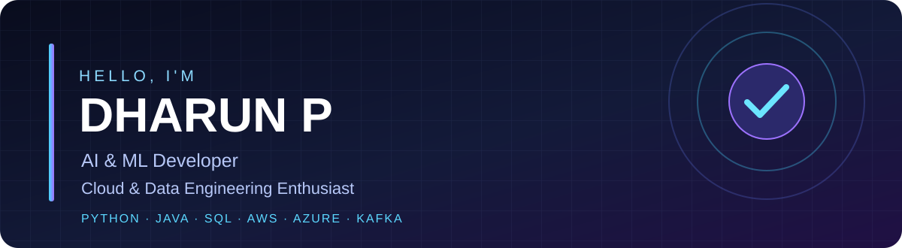

## 👨‍💻 About Me

I'm **Dharun P**, a **B.Tech Computer Science and Engineering (AI & ML)** undergraduate at **Jain University (2023–2027)**, based in **Bengaluru, India**. I enjoy solving technical problems and building practical software—from REST APIs and database-driven applications to AI-assisted features, cloud workflows, and real-time data pipelines.

- 🔭 **Interests:** AI/ML development, software engineering, cloud computing, data engineering and automation
- 🧠 **Core foundations:** Object-oriented programming, data structures & algorithms, DBMS and operating systems
- 🛠️ **Hands-on work:** Python, Java, SQL, Kafka, Spark, Flink, AWS and Azure
- 💬 **Let's connect:** [LinkedIn](https://www.linkedin.com/in/dharun-p-a9493a28a/) · [Email](mailto:dharunperiyasamy2005@gmail.com)

## 🧰 Tech Stack

**Languages, databases & AI**

     

**Cloud & streaming**

     

**Developer tools**

  

## 🚀 Featured GitHub Repositories

> Explore my completed projects and practical engineering work.

| Project | Focus |
| :--- | :--- |
| [Numerical Optimization](https://github.com/Dharun6380/Numerical-Optimization) | Numerical optimization and feature selection |
| [ReachInbox](https://github.com/Dharun6380/ReachInbox) | Application development and email workflow tooling |
| [Data Engineering Lab – Cloud](https://github.com/Dharun6380/Data-Engineering-Lab-Cloud) | Cloud-based data engineering exercises |
| [DSA – Kafka](https://github.com/Dharun6380/DSA-KAFKA) | Kafka messaging and streaming experiments |
| [HCLTech – Cloud Data Engineer](https://github.com/Dharun6380/HCLTech---Cloud-Data-Engineer) | Cloud data engineering coursework and practice |

## 🧪 Additional Completed Projects

| Project | Work completed |
| :--- | :--- |
| **BudgetLens** | Google Sheets financial projection model with scenarios, sensitivity analysis and a summary dashboard |
| **Adaptive Smart Keyboard with AI Interaction** | REST APIs, feature-usage analytics and AI-assisted text interaction |
| **RetailScope** | Retail sales analysis using Python (Pandas), SQL and visualizations |
| **Kafka Food Delivery Anomaly Detection** | Kafka-based food-order streaming, anomaly detection and a Streamlit dashboard |

## ☁️ Practical Engineering Experience

- **Streaming & distributed systems:** Kafka producer/consumer workflows, Spark Streaming, Flink word-count experiments and Storm integration
- **AWS:** EC2, S3, IAM, RDS, VPC, Glue Data Catalog, Glue ETL and related cloud labs
- **Azure:** Virtual machines, storage and e-commerce cloud architecture exercises
- **AI & computer vision:** OpenCV face and facial-feature detection, ML experimentation and recommendation systems

## 💼 Internship

**Database Intern — Tamil Nadu Newsprint and Papers Limited (TNPL)** 
*June 2025 – July 2025 · Karur*

- Developed and optimized **Oracle PL/SQL** scripts supporting ERP backend database operations.
- Troubleshot database issues and maintained technical documentation.

## 🎓 Education & Courses

**Jain University** — B.Tech, Computer Science and Engineering (AI & ML) · **2023–2027**

Courses listed on my resume:
- Java Programming — E&ICT Academy, IIT Kanpur
- Generative AI in Education — University of Glasgow
- Artificial Intelligence Masterclass + ChatGPT
- Dynamic Programming, Greedy Algorithms — University of Colorado Boulder

## 📈 GitHub Insights

### 🐍 Contribution Activity

GitHub charts use third-party image services and may occasionally be unavailable. The snake appears after the GitHub Actions workflow completes successfully.

---

### Let's Build Something Useful

[LinkedIn](https://www.linkedin.com/in/dharun-p-a9493a28a/) · [Email](mailto:dharunperiyasamy2005@gmail.com) · [Resume](assets/Dharun_P_Resume.pdf)

*Thanks for visiting my profile!*

